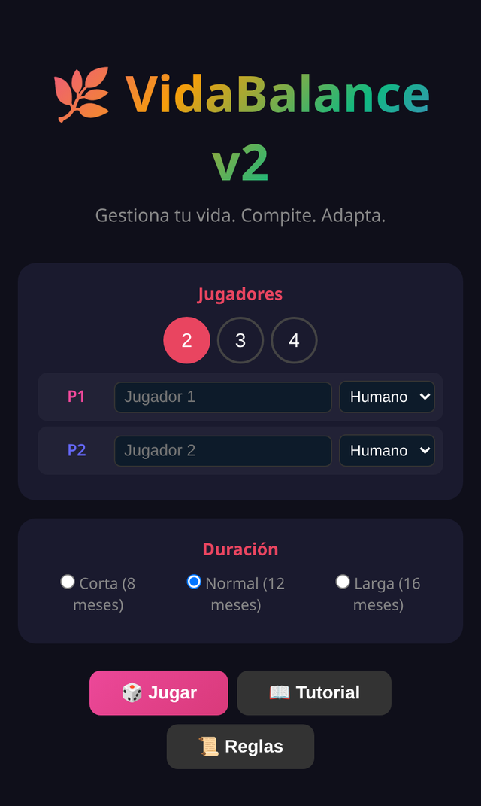

# 🌿 VidaBalance

> Juego de mesa digital de equilibrar tu vida: reparte tu tiempo y energía entre trabajo, salud y ocio, y acumula más felicidad que los demás.

**[▶ Jugar ahora](https://juliangdeveloper.github.io/vidabalance-v2/)** · gratis, en el navegador, sin instalar

## Cómo se juega
- 2 a 4 jugadores en un mismo dispositivo; cada puesto puede ser humano o IA (fácil, media o difícil). Partidas de 8, 12 o 16 meses.
- Cada mes tienes 4 acciones y colocas tu tiempo en 8 actividades compartidas (worker placement): trabajo, freelance, ejercicio, aprender, hobbie, social, salud y descanso.
- Administras ⚡ energía, 💰 dinero y ⏰ tiempo para ganar ❤️ felicidad.
- Cada mes trae una carta de evento con dos opciones y cartas sociales que afectan a todos.
- Fatiga: repetir la misma actividad varios meses seguidos resta felicidad y cuesta más energía.
- Puntaje final: felicidad + habilidades + dinero + bonus de vida balanceada. Incluye tutorial.

## Stack
Un solo `index.html` con HTML, CSS y JavaScript vanilla. Sin dependencias ni servidor.

## Otros juegos de fiesta
- 🌊 [Flood-It Party](https://github.com/juliangdeveloper/floodit-party) · [jugar](https://juliangdeveloper.github.io/floodit-party/)
- 💥 [Clickomania Party](https://github.com/juliangdeveloper/clickomania-party) · [jugar](https://juliangdeveloper.github.io/clickomania-party/)
- 🔷 [HexaSort Party](https://github.com/juliangdeveloper/hexasort-party-v2) · [jugar](https://juliangdeveloper.github.io/hexasort-party-v2/)

---

Más proyectos: https://juliangdeveloper.github.io/
